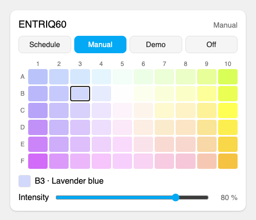

# Skylight Lamp for Home Assistant

🇵🇱 [Polska wersja](README.pl.md)

Unofficial Home Assistant integration for **Skylight Wi-Fi aquarium lamps**
(ENTRIQ and other lamps controlled by the **SLcontrol** app). It works fully
locally: Home Assistant talks to the lamp over your home network, without any
cloud. Tested with **ENTRIQ FL.60** (model `ENT.F.60`, firmware 2.0.4).

Entity ids below are the ones created on an English installation; with another
Home Assistant language the names (and ids) follow the translation.

## What it is for

The Skylight lamp has a built-in Wi-Fi controller, but the SLcontrol app only
works on the same network as the lamp. This integration adds the lamp to Home
Assistant, so you can control it from anywhere through the Home Assistant app
(Nabu Casa, VPN or any other remote access to HA) and use it in automations.

## How it works

The lamp's controller (ESP32) runs a simple HTTP server on port 80 – the same
one the SLcontrol app uses. Every 30 seconds the integration reads the mode,
schedule, lamp clock and Wi-Fi signal; commands (off, manual mode with a
colour from the palette, demo, back to schedule) are sent with the same
requests the app uses. The schedule stored in
the lamp is never changed.

## Installation

**HACS:** HACS → ⋮ menu → *Custom repositories* → URL of this repository,
category *Integration* → install **Skylight Lamp** → restart Home Assistant.

**Manual:** copy `custom_components/skylight_lamp` to
`config/custom_components/` and restart Home Assistant.

## Configuration

1. Give the lamp a fixed IP address in your router (DHCP reservation).
2. *Settings → Devices & services → Add integration → Skylight Lamp*.
3. Enter the lamp's IP address.

The lamp is identified by its MAC address – if its IP changes, add it again
with the new address and the existing entry is updated.

## Entities

| Entity | Description |
|---|---|
| `light.<lamp>` | Turn on / brightness / colour / effect → manual mode. A colour from the colour wheel is matched to the closest palette colour, and the light shows the colour it is lit with (also from the schedule). Effects are the colours of the SLcontrol palette (e.g. "F10 · Amber"). Turn off → lamp off. The state shows the real level: in schedule mode, the level the schedule asks for right now. |
| `select.<lamp>_mode` | Schedule / Manual / Demo / Off |
| `select.<lamp>_colour` | Colour of the SLcontrol palette – name and cell as in the app, e.g. "B5 · Neutral white" |
| `number.<lamp>_intensity` | Intensity in manual mode (0–100 %) |
| `switch.<lamp>_keep_manual_mode_on` | On: manual mode stays until changed. Off: the lamp goes back to the schedule after one hour (the "Set … as default" stars in the app; stored in the lamp) |
| `button.<lamp>_resume_schedule` | Back to the automatic schedule stored in the lamp |
| `sensor.<lamp>_schedule_level` | Level (%) the schedule asks for now; schedule points in attributes |
| `sensor.<lamp>_wi_fi_signal` | Wi-Fi signal strength (diagnostic) |
| `sensor.<lamp>_lamp_clock` | Lamp clock (diagnostic, disabled by default) |

## Card

The integration ships its own card that looks like the manual page of
SLcontrol: mode buttons, the colour palette drawn in the app's colours (colour
name on hover and below the palette) and the intensity slider. The card loads
by itself – no need to add it to the dashboard resources.

```yaml
type: custom:skylight-lamp-card
entity: light.entriq60   # optional, the first Skylight lamp by default
title: Aquarium          # optional, false hides the header
```



## Colours

The palette as in SLcontrol: columns 1→10 go from cool (blue) to warm
(yellow), rows A→F from a green tint to a pink tint. B5 is neutral white.

| | 1 | 2 | 3 | 4 | 5 | 6 | 7 | 8 | 9 | 10 |
|---|---|---|---|---|---|---|---|---|---|---|
| **A** | Blue | Light blue | Sky blue | Ice blue | Mint white | Green-tinted white | Pale green | Pistachio | Light lime | Lime |
| **B** | Cornflower | Light cornflower | Lavender blue | Cool white | Neutral white | Cream white | Vanilla | Pale yellow | Lemon | Yellow-green |
| **C** | Indigo | Lavender | Pale lavender | Lavender white | Pinkish white | Warm white | Light cream | Cream | Straw | Yellow |
| **D** | Violet | Lilac | Light lilac | Lilac white | Pink white | Peach white | Beige | Light apricot | Light gold | Golden yellow |
| **E** | Purple | Light purple | Heather | Light heather | Pale violet | Powder pink | Light salmon | Salmon | Apricot | Gold |
| **F** | Magenta | Orchid | Light orchid | Pink lilac | Pale pink lilac | Pink mist | Pink | Rose | Peach | Amber |

**Note:** turning the lamp off disables the schedule until you resume it –
remember the *Resume schedule* button, especially when away. Manual mode ends
after one hour unless *Keep manual mode on* is enabled.

## Good to know

- The lamp handles one request at a time; the integration sends them in order.
- The lamp and the SLcontrol app can be used side by side – changes made in
  the app show up in Home Assistant on the next refresh.
- **Security:** the lamp's `/statusPage` returns your Wi-Fi password without
  any authentication. The integration does not use that page and drops the
  password from the Wi-Fi status answer right away (it never reaches logs or
  entities). Consider keeping the lamp on a separate IoT network.

## Protocol summary

All requests are `GET http://<lamp>/scheduleSettings?...`:

| Query | Meaning |
|---|---|
| `ctrl=g0` | name and model (UTF-16LE hex), MAC |
| `ctrl=g1` | clock: sntp, Y, M, D, h, m, s |
| `ctrl=gt1` | PWM frequency, channel outputs, manual intensity/colour, calibration, night mode |
| `ctrl=g30` | mode (0 off, 1 schedule, 2 manual), schedule enabled, active point, points |
| `ctrl=g31` | schedule `hour;minute;second;colour;intensity:` |
| `ctrl=g4` | Wi-Fi: SSID, status, **password**, SSID, RSSI, … |
| `ctrl=gu2` | seconds left in manual mode, `-10` = manual mode is permanent |
| `ctrl=gu1` / `ctrl=gu3` | manual mode for one hour / permanent (then `params=6` stores it) |
| `ctrl=74<c1>h<c2>i<c3>j<c4>k<colour>l<intensity>m` | manual mode: four channel levels in %, colour index (A1 = 0 … F10 = 59), intensity → `LED_PWM all channels diagnostic.` |
| `params=6` | store settings → `Schedule has been stored.` |
| `params=9` | off → `Lamp is turned off.` |
| `params=a` | schedule → `Lamp is turned on.` |
| `params=c9001` | demo → `Demo mode started.` |
| `params=h_4_<c1>_<c2>_<c3>_<c4>_` | manual with channel levels only (limited at night, not used) → `Lamp is in manual mode.` |

A colour is the ratio of the four channels; the table recorded from SLcontrol
is in `custom_components/skylight_lamp/colours.py`.

## Development

```sh
python3 -m venv .venv
.venv/bin/pip install -r requirements_test.txt
.venv/bin/pytest
.venv/bin/ruff check . && .venv/bin/ruff format --check .
```

## Disclaimer

This is an unofficial project, not affiliated with or endorsed by the maker of
Skylight lamps or the SLcontrol app. Use at your own risk.
