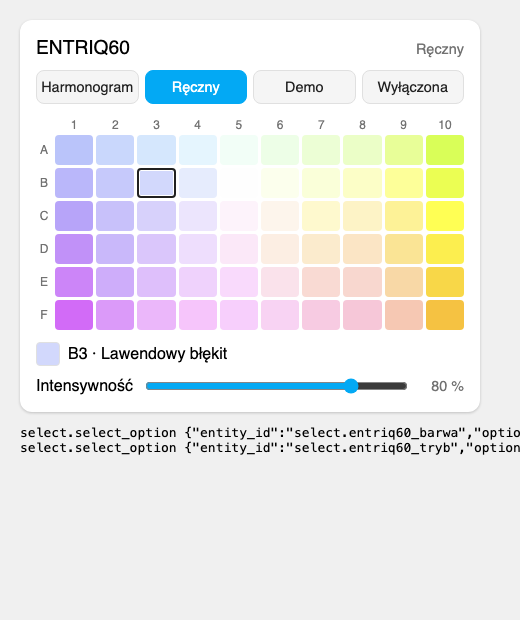

# Skylight Lamp dla Home Assistant

🇬🇧 [English version](README.md)

Nieoficjalna integracja Home Assistant dla **lamp akwariowych Skylight z Wi-Fi**
(ENTRIQ i inne lampy sterowane aplikacją **SLcontrol**). Działa w pełni lokalnie:
Home Assistant rozmawia z lampą w sieci domowej, bez chmury. Sprawdzona z
**ENTRIQ FL.60** (model `ENT.F.60`, firmware 2.0.4).

Identyfikatory encji poniżej to te z instalacji po polsku; w innym języku Home
Assistant nazwy (i identyfikatory) wynikają z tłumaczenia.

## Po co to jest

Lampa Skylight ma wbudowany sterownik Wi-Fi, ale aplikacja SLcontrol działa
tylko w tej samej sieci co lampa. Ta integracja dodaje lampę do Home
Assistant, więc możesz nią sterować z dowolnego miejsca przez aplikację Home
Assistant (Nabu Casa, VPN albo inny zdalny dostęp do HA), a także w
automatyzacjach.

## Jak to działa

Sterownik lampy (ESP32) ma prosty serwer HTTP na porcie 80 – ten sam, z
którego korzysta aplikacja SLcontrol. Integracja co 30 sekund odczytuje tryb
pracy, harmonogram, zegar lampy i sygnał Wi-Fi, a polecenia (wyłącz, tryb
ręczny z barwą z palety, demo, powrót do harmonogramu) wysyła tymi samymi
zapytaniami co aplikacja.
Harmonogram zapisany w lampie nie jest zmieniany.

## Instalacja

**HACS:** HACS → menu ⋮ → *Własne repozytoria* → adres tego repozytorium,
kategoria *Integracja* → zainstaluj **Skylight Lamp** → uruchom ponownie Home
Assistant.

**Ręcznie:** skopiuj katalog `custom_components/skylight_lamp` do
`config/custom_components/` i uruchom ponownie Home Assistant.

## Konfiguracja

1. Przypisz lampie stały adres IP w routerze (rezerwacja DHCP).
2. *Ustawienia → Urządzenia i usługi → Dodaj integrację → Skylight Lamp*.
3. Podaj adres IP lampy.

Lampa jest rozpoznawana po adresie MAC – gdy zmieni adres IP, dodaj ją
ponownie z nowym adresem, a integracja zaktualizuje istniejący wpis.

## Encje

Identyfikatory encji są angielskie w każdym języku Home Assistant (np. `select.<lamp>_mode`
także w polskiej instalacji, a nie `select.<lampa>_tryb`); nazwy wyświetlane są przetłumaczone.

| Encja | Opis |
|---|---|
| `light.<lampa>` | Włącz / jasność / kolor / efekt → tryb ręczny. Kolor z koła barw jest dopasowywany do najbliższej barwy z palety, a światło pokazuje barwę, która świeci (także z harmonogramu). Efekty to barwy z palety SLcontrol (np. „F10 · Bursztynowy”). Wyłącz → lampa wyłączona. Stan pokazuje faktyczny poziom: w trybie harmonogramu – poziom wynikający z harmonogramu w tej chwili. |
| `select.<lampa>_tryb` | Harmonogram / Ręczny / Demo / Wyłączona |
| `select.<lampa>_barwa` | Barwa z palety SLcontrol – nazwa i pole jak w aplikacji, np. „B5 · Neutralna biel” |
| `number.<lampa>_intensywnosc` | Intensywność w trybie ręcznym (0–100 %) |
| `switch.<lampa>_tryb_reczny_na_stale` | Włączony: tryb ręczny trwa do odwołania. Wyłączony: po godzinie lampa wraca do harmonogramu (to samo co gwiazdki „Ustaw … jako domyślny” w aplikacji; zapisywane w lampie) |
| `button.<lampa>_wroc_do_harmonogramu` | Przywraca automatyczny harmonogram zapisany w lampie |
| `sensor.<lampa>_poziom_z_harmonogramu` | Ile procent harmonogram przewiduje teraz; w atrybutach punkty harmonogramu |
| `sensor.<lampa>_sygnal_wi_fi` | Siła sygnału Wi-Fi (diagnostyka) |
| `sensor.<lampa>_zegar_lampy` | Czas na zegarze lampy (diagnostyka, domyślnie wyłączony) |

## Karta

Integracja ma własną kartę, która wygląda jak ekran trybu ręcznego w
SLcontrol: przyciski trybów, paleta barw w kolorach z aplikacji (nazwa barwy
po najechaniu lub pod paletą) i suwak intensywności. Karta ładuje się sama –
nie trzeba dodawać jej do zasobów panelu.

```yaml
type: custom:skylight-lamp-card
entity: light.entriq60   # opcjonalnie, domyślnie pierwsza lampa Skylight
title: Akwarium          # opcjonalnie, false ukrywa nagłówek
```



## Barwy

Paleta jak w SLcontrol: kolumny 1→10 idą od barw chłodnych (niebieskich) do
ciepłych (żółtych), wiersze A→F od odcienia zielonkawego do różowego. B5 to
neutralna biel.

| | 1 | 2 | 3 | 4 | 5 | 6 | 7 | 8 | 9 | 10 |
|---|---|---|---|---|---|---|---|---|---|---|
| **A** | Niebieski | Jasnoniebieski | Błękitny | Lodowy błękit | Miętowa biel | Zielonkawa biel | Jasnozielony | Pistacjowy | Jasna limonka | Limonkowy |
| **B** | Chabrowy | Jasnochabrowy | Lawendowy błękit | Chłodna biel | Neutralna biel | Kremowa biel | Waniliowy | Jasnożółty | Cytrynowy | Żółtozielony |
| **C** | Indygo | Lawendowy | Jasnolawendowy | Lawendowa biel | Różowawa biel | Ciepła biel | Jasnokremowy | Kremowy | Słomkowy | Żółty |
| **D** | Fioletowy | Liliowy | Jasnoliliowy | Liliowa biel | Różowa biel | Brzoskwiniowa biel | Beżowy | Jasnomorelowy | Jasnozłoty | Złotożółty |
| **E** | Purpurowy | Jasnopurpurowy | Wrzosowy | Jasnowrzosowy | Bladofiołkowy | Pudrowy róż | Jasnołososiowy | Łososiowy | Morelowy | Złoty |
| **F** | Magenta | Orchidea | Jasna orchidea | Różowoliliowy | Bladoróżowoliliowy | Różowa mgiełka | Różowy | Różany | Brzoskwiniowy | Bursztynowy |

**Uwaga:** wyłączenie lampy wyłącza harmonogram aż do jego przywrócenia –
pamiętaj o przycisku *Wróć do harmonogramu*, zwłaszcza gdy jesteś poza domem.
Tryb ręczny kończy się po godzinie, chyba że włączysz *Tryb ręczny na stałe*.

## Dobrze wiedzieć

- Lampa obsługuje jedno zapytanie naraz; integracja wysyła je po kolei.
- Lampa i aplikacja SLcontrol mogą być używane równolegle – zmiany z aplikacji
  pojawią się w Home Assistant przy kolejnym odczycie.
- **Bezpieczeństwo:** strona `/statusPage` lampy zwraca bez logowania hasło do
  Twojej sieci Wi-Fi. Integracja z niej nie korzysta, a hasło z odpowiedzi o
  stanie Wi-Fi odrzuca od razu (nie trafia do logów ani encji). Rozważ
  trzymanie lampy w osobnej sieci IoT.

## Protokół (skrót)

Wszystkie zapytania to `GET http://<lamp>/scheduleSettings?...`:

| Zapytanie | Znaczenie |
|---|---|
| `ctrl=g0` | name and model (UTF-16LE hex), MAC |
| `ctrl=g1` | clock: sntp, Y, M, D, h, m, s |
| `ctrl=gt1` | PWM frequency, channel outputs, manual intensity/colour, calibration, night mode |
| `ctrl=g30` | mode (0 off, 1 schedule, 2 manual), schedule enabled, active point, points |
| `ctrl=g31` | schedule `hour;minute;second;colour;intensity:` |
| `ctrl=g4` | Wi-Fi: SSID, status, **password**, SSID, RSSI, … |
| `ctrl=gu2` | seconds left in manual mode, `-10` = manual mode is permanent |
| `ctrl=gu1` / `ctrl=gu3` | manual mode for one hour / permanent (then `params=6` stores it) |
| `ctrl=74<c1>h<c2>i<c3>j<c4>k<colour>l<intensity>m` | manual mode: four channel levels in %, colour index (A1 = 0 … F10 = 59), intensity → `LED_PWM all channels diagnostic.` |
| `params=6` | store settings → `Schedule has been stored.` |
| `params=9` | off → `Lamp is turned off.` |
| `params=a` | schedule → `Lamp is turned on.` |
| `params=c9001` | demo → `Demo mode started.` |
| `params=h_4_<c1>_<c2>_<c3>_<c4>_` | manual with channel levels only (limited at night, not used) → `Lamp is in manual mode.` |

Barwa to proporcja czterech kanałów; tabela odczytana z SLcontrol jest w `custom_components/skylight_lamp/colours.py`.

## Rozwój

```sh
python3 -m venv .venv
.venv/bin/pip install -r requirements_test.txt
.venv/bin/pytest
.venv/bin/ruff check . && .venv/bin/ruff format --check .
```

## Zastrzeżenie

Projekt nieoficjalny, niezwiązany z producentem lamp Skylight ani aplikacji
SLcontrol i nieautoryzowany przez nich. Używasz na własną odpowiedzialność.
